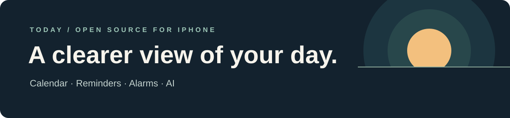

# Today

**Calendar, reminders and alarms, together in one native iPhone app.** Today brings the things you need to do and the time you have into a single view, with an AI assistant to help you make changes.

[Explore the iOS app](ios/README.md) · [Build from source](#build-from-source) · [Contribute](#contributing) · [Report an issue](https://github.com/luworks/today/issues)

## A day that makes sense at a glance

- **One timeline.** See events, reminders, alarms and free time together, with overdue items kept visible.
- **Familiar Apple data.** Connect to Apple Calendar and Reminders; their stores remain the source of truth. Alarms use AlarmKit.
- **Ask in your own words.** Create or change plans with AI. Clear requests can be applied directly with Undo; changes with wider consequences wait for confirmation. Preview First is available in Settings.
- **See what’s next.** Widgets and a Lock Screen Live Activity surface upcoming items. Timers, a world clock and an optional Health summary round out the day.

## Project status

Today is under active development and is iterated on daily. The SwiftUI app in [`ios/`](ios/) is the product; the HTML prototype in [`src/`](src/) is an older design reference. There is currently no GitHub release to download. Build from source to explore the project; signed device installation and distribution have separate requirements.

## Privacy, with context

Planner and health records are designed to stay on the device. When using hosted AI, the submitted message and limited relevant context are sent to the configured AI service. Travel estimates send location and event addresses to Apple Maps. Apple Calendar and Reminders access requires your permission. See the [product principles](CLAUDE.md) for details.

## Build from source

You'll need a Mac and the pinned Xcode toolchain. The current project guide specifies **Xcode 27.2 (27B52)** and an **iOS 27.0** deployment target. From the repository root:

```sh
./dev doctor
./dev bootstrap
./dev generate
./dev resolve
./dev build Debug
```

See the [iOS development guide](ios/README.md) for prerequisites, simulator workflows, signing limitations and troubleshooting. A simulator build does not verify physical-device behavior.

## Contributing

Issues, fixes and thoughtful feedback are welcome. To get started:

1. Browse [open issues](https://github.com/luworks/today/issues) or describe a problem with steps to reproduce.
2. Read the [product principles](CLAUDE.md), [development guide](ios/README.md), and [contributor working rules](AGENTS.md).
3. Make a focused change, explain the user-visible behavior and open a pull request. The repository's CI runs the required checks.

The app is organized into linked Swift modules; the [architecture guide](docs/engineering/architecture.md) is a good starting point for code changes.

## License

[MIT](LICENSE). The bundled World Clock city data is derived from [GeoNames](https://www.geonames.org/) under CC BY 4.0; see the [iOS guide](ios/README.md#credits).
