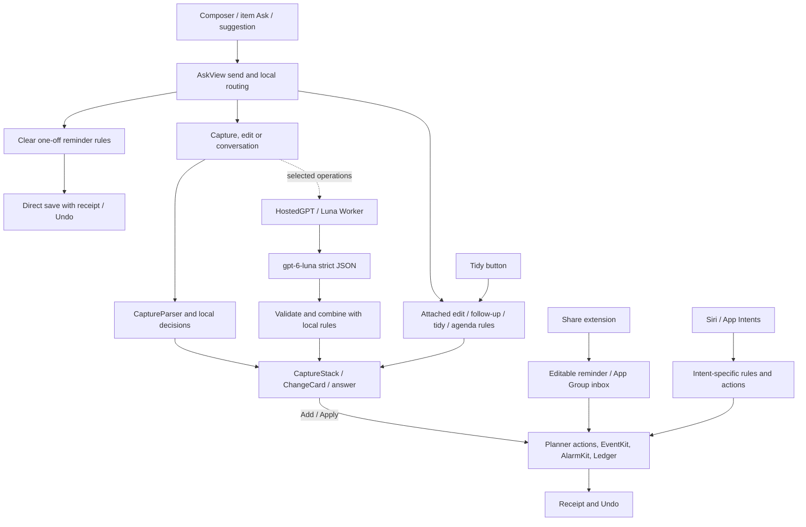

# Today AI architecture

> Target design: [ai-agent-architecture.md](ai-agent-architecture.md) replaces this pipeline; this file remains the as-is audit until the migration (P4) deletes it.

Snapshot: `main` at `c89cbdb4f4cf30ed3c9883b5cca2598484cfa58a`, inspected 2026-10-30. This is a static code audit, not a production health check or a new evaluation. The native iOS app is the product; the HTML prototype's `isQuestion` and scripted reply are not its implementation. Paths below are repository-relative.

## Overview

Today has several independent rule-led paths, with optional hosted Luna calls for selected tasks. Production `AskIntelligence.live` chooses hosted or rules; despite older comments and documentation saying Foundation Models (FM), there is no active FoundationModels invocation in the current production Swift sources. Historical FM experiments are not a current fallback. `HostedGPT.isAvailable` checks configuration, not connectivity, valid authorization, remaining quota or model success. Even when configured, many requests are decided locally. See `ios/Sources/Features/FeatureAsk/AskIntelligence.swift`, `HostedGPT.swift`, and `AskView.swift`.

## Entry points and routing

* The bottom composer opens Ask; Reminder/Event/Alarm quick kinds prefix an instruction to the submitted text while the visible message stays as typed (`AskQuickKind`, `AskView.send`). Voice input fills the composer. An item long-press opens Ask with `AskSubject` for a reminder, event or alarm. Its local identity is retained separately from the text supplied to a model. Attached edits resolve identity first; #247 and #250 are merged, including supported attached system-event moves. Unsupported or stale targets fail closed.
* Empty-chat chips are rule candidates from `AskSuggestions` and `AskSuggestionContext`; `SentenceRoute` screens actionable sentences. `AskSuggestionRanker` optionally asks Luna to rerank/reword supplied candidates, validates IDs/meaning through the blend, and falls back to rules after two seconds. Although similar, `SentenceRoute` is not the main Ask send router: `ChatRouting`, special-case checks and `Dialogue` participate independently.
* `AskView.send` builds context before appending the new turn. It checks attached edits, saved-reminder refinement, correction ambiguity and the narrow direct-create rule, then contextual continuation, conversation/agenda, open follow-ups, overdue tidy, editing and capture. This ordering matters. An agenda question uses a local summary; general conversation may use Luna or a local fallback. `Dialogue` resolves answers and modifies pending previews.
* Tidy is also available from the Today overdue row (`TidySheet`). `OverdueTidy` is deterministic: it proposes editable choices for overdue reminders, and Apply performs the changes. It is not a model-generated plan.
* Share extension (`ios/ShareExtension`, `TodayShared/ShareInbox.swift`) takes shared text/page into an editable reminder, then writes an App Group inbox on Add; the app imports it. It does not invoke the chat model. App Intents (`One/AppIntents.swift`, `AlarmIntents.swift`, `TimerIntents.swift`) use intent-specific parsing and actions: Add Reminder uses CaptureParser, alarm phrases use rule parsing, and timer/Next Up/Open Today have their own logic. Siri intent execution is not the Ask pipeline.

## Engines, outputs and writes

`Understander.parse` first runs `CaptureConversation`/`CaptureParser`; clear kind is determined by rules, otherwise a hosted classifier may run with an eight-second deadline and fall back to the parsed result. An optional title-only hosted refinement follows, bounded to four seconds, and cannot change scheduling fields. This can be two sequential model calls. `AICapture.propose` uses hosted structured extraction for multi-action input (up to five items, 12-second deadline); if unavailable or unsuccessful Ask asks for separate messages instead of silently collapsing the list. Conversation has an eight-second hosted path with local fallback (`ChatResponse`). Editing tries local matching first; ambiguous edits may use hosted planning with a 20-second deadline and otherwise ask the user to name the item. Different paths therefore have different fallbacks and latency, not a uniform engine cascade.

The Luna Worker (`backend/luna/worker.mjs`) uses `gpt-6-luna`, medium reasoning, `store: false` and strict JSON schemas. It does not supply model tools or function calls: the app validates structured results and decides what can be shown or written. Hosted configuration normally requires explicit cloud consent, an endpoint and bearer session; a DEBUG simulator proxy is a separate development route. Current auth is username/password with PBKDF2, 30-day bearer sessions and Keychain client storage, not App Attest. The Worker enforces 6 requests/minute and 40/UTC day **per user**, plus a cumulative $0.50 global budget with per-request reservation accounting. These are code/configuration observations, not evidence of live quota availability or deployment. App Attest work in the existing lead thread remains unresolved on device identity and quota inheritance.

A capture becomes one or more `CaptureStack` cards. Existing-item edits produce `ChangeCard` or clarification; overdue tidy has its own card; conversation can return plain text. Add/Apply routes through `PlannerActions`/`TaskActions`, persistence and system adapters to EventKit or AlarmKit where appropriate, with ledger entries and guarded Undo receipts. System-event move previews expose occurrence/attendee consequences. The scoped exception is a clear actionable one-off reminder in submitted chat: Send authorizes direct creation, provided rule checks pass; the same commit/receipt path reports Added only after the required save, preserves a recoverable draft on failure, and offers Undo/Open. This exception does not authorize automatic event, alarm, recurring, edit or delete writes. `AskView.swift` around `send`, `createSubmittedReminder`, `commit`, `AskNativeActions` and `applyTidy`; `One/TaskActions.swift` and `CapturePersistence.swift` contain the boundaries.

## Context and privacy

`ConversationContext` reconstructs a prompt from recent conversation: up to eight turns, 400 characters per turn and a 1,600-character budget, plus an attached subject line where present (`TodayCore/ConversationHistory.swift`). `AskSubject` sanitizes and bounds its title/facts; its stable item reference is not sent to the model. The latest message is sent separately. There is no shared persistent model session. A general hosted chat does not automatically receive the user's entire planner. The local agenda summary includes open/overdue reminders and upcoming local events for today, displaying at most five tasks and three events; it is not a month-wide analysis. For edit disambiguation, the prompt may include candidate IDs, types, titles, times, duration and attendee counts from open tasks and next-week events. Suggestion ranking can send the candidate sentences plus bounded facts such as current time, next event, free minutes and counts. Capture, title, edit, conversation and suggestion prompts are constructed separately; see `Understanding.swift`, `AICapture.swift`, `Editing.swift`, `ChatResponse.swift` and `AskSuggestionRanker.swift`.

Cloud requests send submitted text and relevant bounded context to the configured service. Worker documentation states that planner/chat text is not stored in its account database; this is not independent verification of external service retention. Rules and local summary run on device. The model has no direct database or system-action tool in this pipeline.

## Storage and history

`ChatThread` stores messages, subject and timestamps in SwiftData; the first user message creates a thread and later messages update it. Sidebar archive/delete/rename and automatic finished-chat archive operate on these threads; continuing an archived chat unarchives it. `ConversationHistory` builds bounded context; `Dialogue` manages follow-ups rather than being the durable store. `StoredCard` persists decided capture cards (`CardStatus`: open, added, dropped, undone) and explicitly retained recovery drafts; ordinary open previews are not restored. Change and tidy transient state should not be assumed to have the same persistence. `AskView.persist` and `persistCards` use `try? context.save()`: a UI response alone is not proof of durable storage.

Activity is a separate on-device SQLite store (`TodayData/ActivityStore`, `ActivityRecorder`, `One/ActivityCenter` and `Ledger`): it records configured AI turn/card/chip events and change/Undo entries. Chat text in Activity is opt-in; the conversation store itself contains chat messages. Recording is buffered and subject to settings/failure, so its intended coverage is not evidence that every chat or external system change is durably captured. Share/widget events use the app-group outbox and app import. See `ios/README.md` Activity section and code for retention and recovery.

## Evaluation and evidence limits

Tests and fixtures include `ios/Eval/Tests/OneLogicTests` (capture, routing, subjects, dialogue, editing, card state), `ios/OneUITests` Ask journeys, `ios/Eval/Understanding` development and holdout sets, and `tests/fixtures` capture/conversation/title cases. They exercise different contracts and engines, not one shared comparable benchmark. `ios/Eval/TitleQuality` describes an unmeasured set; a fixture count is not a pass rate.

Historical FM `ios/Eval/Understanding/RESULTS.md` reports a macOS 26.6 holdout: parser all-fields 42.5% and model/rules 66.9% on 120 capture cases repeated three times; edit clarify recall 71.4%, unsafe 3/180 on 60 cases repeated three times. These are historical experiments, not current main or iPhone performance. `docs/qa/gpt-luna-effort-20261029.md` reports a repeated development set: low/medium/high 43/48, xhigh 44/48; low p50/p90 1.78/2.75 seconds. It is not blind, independent, or end-to-end app latency.

[Live Intelligence PR #216](https://github.com/luworks/today/pull/216) remains open and draft. Its reported frozen baseline is 24 cases/27 turns, with a separate 24-case/33-turn holdout; candidate-specific multi-item observations (0/1 to 1/1, repeated 3/3) and three one-off examples are small-sample observations, not a general main pass rate. The later content candidate's new-source Live validation is pending. A current comparable rules/Luna/FM pass rate and p50/p90 on main is **unknown**. CI `checks` and `today-required` are the merge gate; they do not run the full Live UI journeys or establish real-device behavior.

## Problems ranked by user impact

1. **Wrong or confusing action is possible at routing and direct-create boundaries.** Multiple rule passes and model paths can disagree on intent, cardinality, date or follow-up slots. #216 is actively investigating multi-action direct-create safeguards; do not represent its candidate as merged. The previous “Which item do you mean?” attached-item failure motivated #247/#250; current code has an identity-first route, but this audit is not a live regression pass.
2. **Limited context makes answers feel unaware.** Ordinary chat does not receive all planner data; the local Today summary is bounded and English, and edit candidates cover a particular window. A request for next month's plan is not supported by merely having authorized data on device. Follow-ups use several state machines and bounded text, making context loss possible.
3. **Availability changes capability and explanations.** Multi-item extraction requires Luna; offline users must split requests. A configured endpoint can still fail, expire, hit quota or time out. No uniform user-visible engine receipt is established here.
4. **Duplicated routing, prompts and schemas invite drift.** Chip `SentenceRoute`, Ask `ChatRouting`, parser, `Dialogue`, edit matcher and hosted extraction own overlapping decisions. `AskView.swift` combines routing, UI, state and writes in 2,492 lines. Old FM descriptions and experimental extraction code such as `Understanding.extract` can mislead; call sites must be checked before removal, and no dead-code claim is made solely from a comment.
5. **Latency and coverage are not measured end to end.** Classification and title refinement can be sequential; edit waits up to 20 seconds, other paths have distinct deadlines. Historical model timings exclude end-to-end device behavior. The #250 PR describes investigation of a timeline smoke regression following #248; its merged status alone does not prove the root cause or current runtime behavior. Preserve regression coverage without claiming an unobserved failure.
6. **Recovery and observability are uneven.** Ordinary open capture previews and transient change/tidy cards are not equivalent to retained decided cards; `try?` saves and buffered Activity mean success must not be inferred from display alone.

## File map

Line counts at the snapshot, including comments and blank lines:

| File | Lines | Responsibility |
| --- | ---: | --- |
| `ios/Sources/Features/FeatureAsk/AskView.swift` | 2492 | Send routing, cards, persistence and actions |
| `ios/Sources/Features/FeatureAsk/AskIntelligence.swift` | 83 | Live/test engine composition |
| `ios/Sources/Features/FeatureAsk/HostedGPT.swift` | 205 | Hosted configuration and transport |
| `ios/Sources/Features/FeatureAsk/Understanding.swift` | 405 | Parser/classifier combination and prompts |
| `ios/Sources/Features/FeatureAsk/AICapture.swift` | 76 | Multi-capture and title refinement |
| `ios/Sources/Features/FeatureAsk/ChatResponse.swift` | 45 | Conversation response |
| `ios/Sources/Features/FeatureAsk/Editing.swift` | 91 | Model-assisted edit plan |
| `ios/Sources/Features/FeatureAsk/AskSuggestionRanker.swift` | 70 | Hosted chip ranking |
| `ios/Sources/Features/FeatureAsk/AskSuggestionContext.swift` | 125 | Candidate context |
| `ios/Sources/Features/FeatureAsk/CaptureStack.swift` | 272 | Capture presentation |
| `ios/Sources/TodayCore/Capture.swift` | 1558 | Capture, parser and capture rules |
| `ios/Sources/TodayCore/AskSuggestions.swift` | 779 | Candidate and sentence routing rules |
| `ios/Sources/TodayCore/AskSubject.swift` | 65 | Attached item context |
| `ios/Sources/TodayCore/Dialogue.swift` | 418 | Follow-up/refinement rules |
| `ios/Sources/TodayCore/ConversationHistory.swift` | 179 | Bounded conversation context |
| `ios/Sources/TodayCore/CaptureCardState.swift` | 118 | Card status and storage |
| `ios/Sources/TodayCore/OverdueTidy.swift` | 92 | Tidy rules |
| `ios/Sources/One/AppIntents.swift` | 170 | Reminder and other intents |
| `ios/Sources/One/AlarmIntents.swift` | 258 | Alarm intents |
| `ios/Sources/One/TaskActions.swift` | 372 | Planner writes |
| `ios/Sources/One/Ledger.swift` | 365 | Changes and Undo ledger |
| `ios/Sources/One/CapturePersistence.swift` | 116 | Capture persistence |
| `backend/luna/worker.mjs` / `schema.sql` | 103 / 18 | Hosted API and accounting schema |
