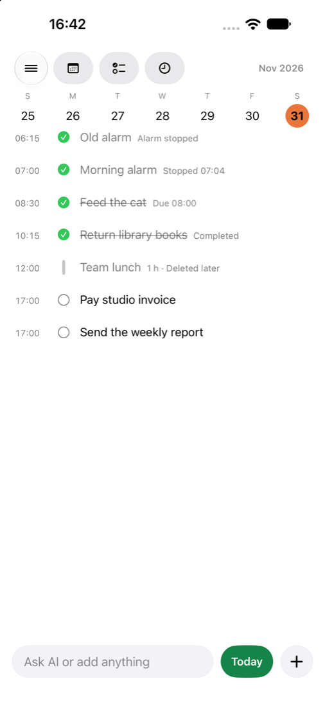
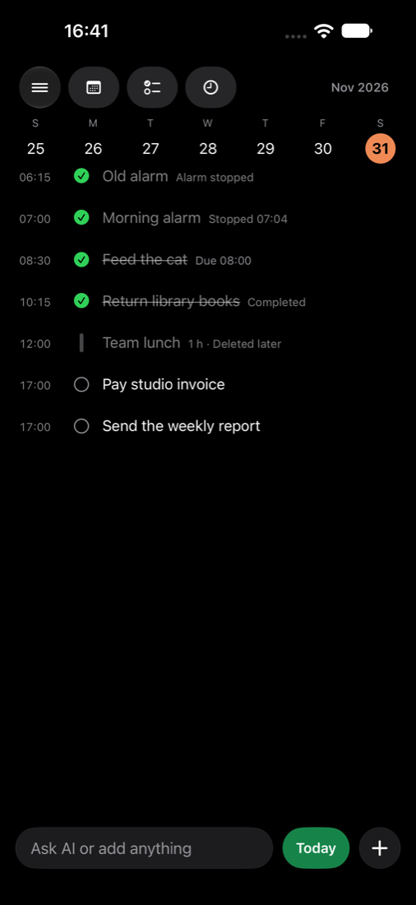

# Past days show what was done (2026-11-01)

Simulator `Today-PastDays` (iPhone 18 Pro Max, iOS 27.0), TodayMock, `-uiTesting -dataset tests/fixtures/today-dataset.json -uiTestingPastDay`, driven with agent-device; yesterday (Sat Oct 31) opened from Calendar → 2 Day.

| Light | Dark |
| --- | --- |
|  |  |

Rows: "Old alarm" (stop recorded, alarm since deleted), "Morning alarm" (its 07:00 ring stopped at 07:04), "Feed the cat" (still in Today, done at 08:30; its ledger row is not shown twice), "Return library books" (completed at 10:15, deleted later; rebuilt from Activity), "Team lunch" (deleted after it happened), and two reminders due that day and not done (open). Not shown: a completion reopened a minute later, a completion undone in Activity, and an event deleted before it began.

UI test: `./dev test ui --only TodayUITests/PastDayHistoryTests/testYesterdayShowsWhatWasDone --only TodayUITests/PastDayHistoryTests/testYesterdayInDarkMode`: 2 passed. Unit: `DayHistoryTests` 11 passed (rules, paging, query plans on `event_kind_day` and `event_kind_before`).
